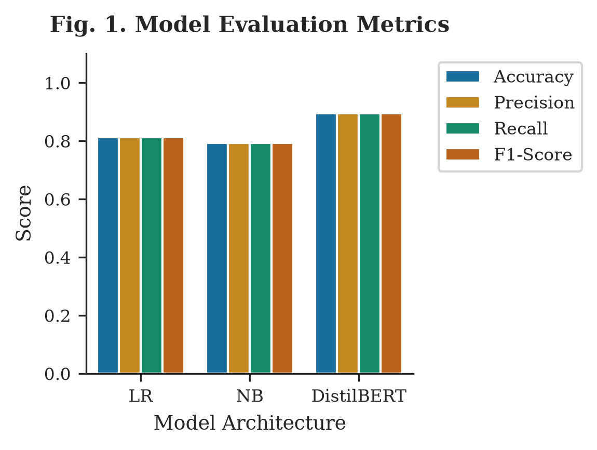
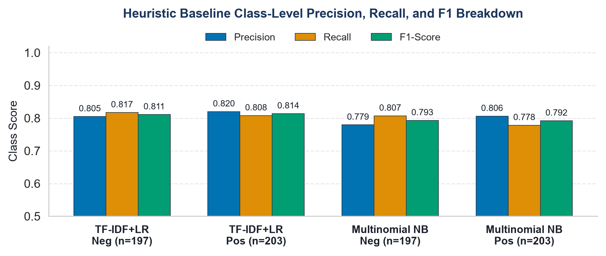

# E-Commerce Sentiment Classification & Complaint Triage

[](https://ecommerce-sentiment-triage.streamlit.app/)
[](https://colab.research.google.com/github/GaneshArwan/nlp_sentiment_analysis/blob/main/notebooks/nlp_sentiment_pipeline.ipynb)

Benchmarking TF-IDF linear and probabilistic baselines against fine-tuned DistilBERT (`distilbert-base-uncased`) on Amazon product reviews, paired with Latent Dirichlet Allocation (LDA) topic extraction on negative reviews for automated complaint triage.

## Problem & Motivation

Bag-of-words models miss negation, multi-word sentiment reversals, and sarcasm in product feedback. At the same time, knowing a review is negative does not route it to the right team. This pipeline separates those two steps:

1. **Sentiment classification** compares TF-IDF + Logistic Regression and Multinomial Naive Bayes against fine-tuned DistilBERT on held-out reviews.
2. **Complaint clustering** fits 5-topic LDA on negative training reviews to group recurring product and hardware defects.

## Dataset

- **Source:** HuggingFace Hub (`fancyzhx/amazon_polarity`, seed `42`)
- **Sampled split (`DataConfig` defaults):** `2,000` training reviews and `400` test reviews (`203` positive / `50.75%`, `197` negative / `49.25%`)
- **Text cleaning (`src/data_loader.py`):** Strips HTML tags, removes digits and punctuation, lowercases, and collapses extra whitespace.

## Results Summary (`N=400` Test Split)

| Model | Precision (Macro) | Recall (Macro) | F1-Score (Macro) | Accuracy |
|---|---|---|---|---|
| TF-IDF + Logistic Regression | `0.813 ± 0.047` | `0.813 ± 0.047` | `0.812 ± 0.047` | `0.813 ± 0.038` |
| TF-IDF + Multinomial Naive Bayes | `0.793 ± 0.049` | `0.793 ± 0.049` | `0.792 ± 0.049` | `0.793 ± 0.040` |
| **DistilBERT (`distilbert-base-uncased`)** | **`0.895 ± 0.037`** | **`0.895 ± 0.037`** | **`0.895 ± 0.037`** | **`0.895 ± 0.030`** |

*Note: Accuracy 95% CIs use binomial standard error; composite Precision, Recall, and F1 CIs apply a conservative variance inflation factor (`VIF = 1.5`) because per-sample test predictions are not persisted.*



### Key Analytical Findings

1. **Significant error reduction:** DistilBERT improved macro F1 by **+8.25 percentage points** (`0.812` to `0.895`) and cut classification error rate by **44.0%** (`18.8%` to `10.5%`, independent two-proportion `z = 3.30, p = 0.0010`) over TF-IDF + Logistic Regression, and by **49.4%** (`z = 3.99, p < 0.0001`) over Multinomial Naive Bayes.
2. **Per-class baseline skew:** TF-IDF + Logistic Regression stayed balanced (`0.817` negative recall vs. `0.808` positive recall), while Multinomial Naive Bayes showed higher negative recall (`0.807`) with lower negative precision (`0.779`).
3. **Negative-review themes (`k=5` LDA):** Extracted topics separate video games/discs, music CDs/albums, books/movies, general product value, and hardware/connector defects (`switch`, `disk`, `broke`, `connector`, `laptop`).



## Quick Start

**Live Dashboard:** [https://ecommerce-sentiment-triage.streamlit.app/](https://ecommerce-sentiment-triage.streamlit.app/)

### 1. Run the Dashboard Locally (Lightweight)

```bash
pip install -r requirements.txt
streamlit run app.py
```

### 2. Run via Docker

```bash
docker build -t nlp-sentiment-dashboard .
docker run -p 8501:8501 nlp-sentiment-dashboard
```

### 3. Re-Run Full Training & Report Generation (Local or Google Colab)

Training dependencies (`torch`, `transformers`, `datasets`, `scikit-learn`, `reportlab`) are separated into `requirements-pipeline.txt` so dashboard deployments stay fast.

```bash
pip install -r requirements-pipeline.txt
python src/baseline_models.py
python src/transformer_finetune.py
python src/report_generator.py
```

Or run end-to-end on a T4 GPU in [notebooks/nlp_sentiment_pipeline.ipynb](notebooks/nlp_sentiment_pipeline.ipynb) using the **Open in Colab** badge above.

### 4. Run Offline Tests & Security Checks

```bash
pytest -v
bandit -r src/ app.py -ll
```

## Project Structure

```text
.
├── app.py                              # Streamlit evaluation dashboard
├── requirements.txt                    # Lightweight runtime deps (Streamlit Cloud & Docker)
├── requirements-pipeline.txt           # Full training, PDF report, and ML deps
├── Dockerfile                          # Non-root container for Streamlit dashboard
├── notebooks/
│   └── nlp_sentiment_pipeline.ipynb    # Reproducible Google Colab pipeline notebook
├── src/
│   ├── data_loader.py                  # HuggingFace subset loader + Pydantic DataConfig
│   ├── baseline_models.py              # TF-IDF + LR/NB classifiers + LDA topic model
│   ├── transformer_finetune.py         # DistilBERT Trainer pipeline (safetensors, seeded)
│   └── report_generator.py             # Dynamic 3-page Model QA PDF & chart generator
├── tests/
│   └── test_pipeline.py                # 62 offline deterministic pytest unit tests
├── baseline_metrics.json               # Saved baseline & per-class evaluation metrics
├── transformer_metrics.json            # Saved DistilBERT evaluation metrics
├── lda_topics.json                     # Extracted LDA negative-review topic terms
├── accuracy_chart.png                  # Overall model comparison chart (300 DPI)
├── class_metrics_chart.png             # Baseline per-class P/R/F1 breakdown chart
└── report.pdf                          # 3-page Data Science & Model QA PDF report
```

## Limitations & Next Steps

- **Sample size (`N=400` test):** Current 95% CIs span `±3–4.9%`; evaluate on `>=10,000` held-out reviews before setting production SLAs.
- **Unpersisted predictions:** Storing raw test probabilities would enable ROC-AUC, Brier calibration curves, and paired McNemar testing.
- **Single-epoch training & fixed `k=5`:** Adding a validation split with early stopping and tuning LDA topic count via coherence scores would tighten both models.
- **Contraction stripping:** `clean_text` removes apostrophes before stop-word filtering, leaving fragments (`dont`, `isnt`, `does`) in LDA topics; expanding contractions prior to tokenization fixes this.
